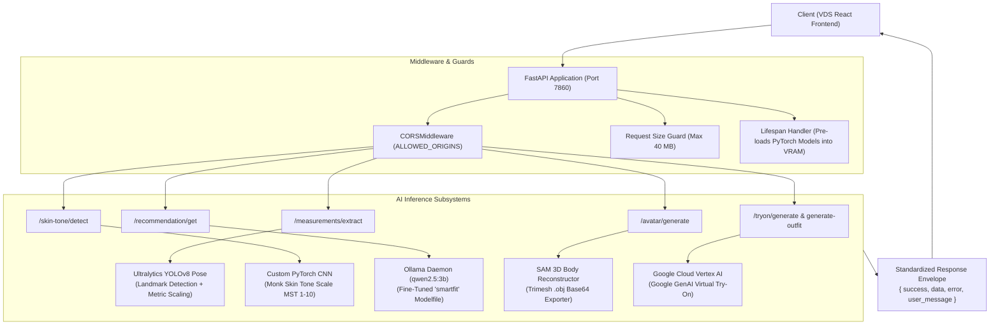

<div align="center">

# 👗 VDS V2 — Virtual Dressing System Backend

**Production-grade FastAPI AI microservice powering anthropometric body measurement, skin tone classification, LLM-based sizing & color recommendation, 3D body reconstruction, and virtual try-on.**

[](https://fastapi.tiangolo.com)
[](https://www.python.org/)
[](https://pytorch.org/)
[](https://developer.nvidia.com/cuda-toolkit)
[](https://www.docker.com/)
[](https://huggingface.co/spaces)

</div>

---

## 📌 Table of Contents

- [Overview](#-overview)
- [System Architecture](#-system-architecture)
- [Core AI Capabilities](#-core-ai-capabilities)
- [API Reference](#-api-reference)
  - [`GET /health`](#get-health)
  - [`POST /measurements/extract`](#post-measurementsextract)
  - [`POST /skin-tone/detect`](#post-skin-tonedetect)
  - [`POST /recommendation/get`](#post-recommendationget)
  - [`POST /avatar/generate`](#post-avatargenerate)
  - [`POST /tryon/generate`](#post-tryongenerate)
  - [`POST /tryon/generate-outfit`](#post-tryongenerate-outfit)
- [Environment Configuration](#-environment-configuration)
- [Local Development Setup](#-local-development-setup)
- [Docker & Cloud Deployment](#-docker--cloud-deployment)
- [Error Handling & Resilience](#-error-handling--resilience)
- [Repository Structure](#-repository-structure)

---

## 🔭 Overview

The **Virtual Dressing System (VDS V2) Backend** provides an end-to-end computer vision and generative AI pipeline tailored for modern e-commerce fashion experiences. Instead of relying on manual size charts, users provide photos and height, from which VDS extracts precise physical body measurements, determines skin tone on the Monk Skin Tone (MST) scale, predicts optimal apparel sizes and color palettes using an on-device LLM, generates an interactive 3D human body mesh, and renders photorealistic virtual try-on images.

The service is packaged as a containerized FastAPI application with built-in GPU acceleration, engineered for zero disk persistence (in-memory image processing) and deployment on **Hugging Face Spaces**.

---

## 🏗 System Architecture

The following diagram illustrates how incoming client requests flow through the FastAPI gateway, preloaded AI models, and external Google Cloud Vertex AI services:



---

## 🧠 Core AI Capabilities

### 1. Anthropometric Body Measurement (`measurement/`)
- Uses **Ultralytics YOLOv8-pose** to detect 2D anatomical landmarks on full-body front and side images.
- Calculates pixel-to-centimeter ratios calibrated by the user's ground-truth height (`height_cm`).
- Computes planar measurements (shoulder width, arm length, inseam) and models body trunk circumferences (chest, waist, hips) using ellipse approximation from combined front and side profiles.

### 2. Skin Tone Classification (`skin_tone/`)
- Analyzes portrait face selfies using a fine-tuned PyTorch neural network (`best_skintone_model.pth`).
- Classifies skin color into standardized Monk Skin Tone (MST) categories (ranging from MST 1 fair to MST 10 deep).
- Extracts central sampled facial pixels, returning both the classified category reference HEX and the individual's sampled HEX.

### 3. SmartFit Sizing & Color Theory (`recommendation/`)
- Powered by a local **Ollama** LLM instance running `qwen2.5:3b`, customized via `Modelfile.txt` as `smartfit`.
- Cross-references anthropometric measurements against international clothing standard tables to output shirt size (`XS`–`XXL`) and pants waist/length format (`W*L`).
- Applies seasonal color analysis to recommend complementary garment colors and warn against unflattering shades, complete with display names and HEX color codes.

### 4. 3D Body Avatar Generation (`avatar/`)
- Utilizes **SAM 3D Body** (built on PyTorch Lightning, Detectron2, and PyRender) to reconstruct a 3D volumetric mesh from a single front-facing photograph.
- Exports the reconstructed human mesh into an `.obj` format and encodes it as base64 for real-time WebGL/Three.js rendering on the client.

### 5. Photorealistic Virtual Try-On (`tryon/`)
- Integrates with **Google Cloud Vertex AI** (using the `google-genai` SDK) to apply garments directly to user portraits.
- Supports single-garment try-on as well as complete outfit try-on (pairing upper-body and lower-body garments simultaneously).

---

## 📡 API Reference

All requests enforce an upper limit of **10 MB per image** and **40 MB total request body**. Image decoding is performed strictly in RAM via OpenCV and NumPy.

### `GET /health`
Verifies backend service availability and API version.

**Response (`200 OK`):**
```json
{
  "status": "ok",
  "version": "2.0.0"
}
```

---

### `POST /measurements/extract`
Calculates body circumferences and limb lengths from front and side photos.

- **Content-Type**: `multipart/form-data`
- **Request Parameters**:

| Field | Type | Required | Description |
|---|---|---|---|
| `front_image` | File (`JPEG`, `PNG`, `WebP`) | Yes | Full-body front pose |
| `side_image` | File (`JPEG`, `PNG`, `WebP`) | Yes | Full-body side profile |
| `height_cm` | Float (`100.0`–`250.0`) | Yes | User height in centimeters |

**Response (`200 OK`):**
```json
{
  "success": true,
  "measurements": {
    "shoulder_width_cm": 44.5,
    "chest_circumference_cm": 98.2,
    "waist_circumference_cm": 82.0,
    "hip_circumference_cm": 99.4,
    "arm_length_cm": 61.3,
    "inseam_cm": 80.5
  },
  "diagnostics": {},
  "error": null,
  "user_message": null
}
```

---

### `POST /skin-tone/detect`
Classifies skin complexion from a face portrait.

- **Content-Type**: `multipart/form-data`
- **Request Parameters**:

| Field | Type | Required | Description |
|---|---|---|---|
| `person_image` | File (`JPEG`, `PNG`, `WebP`) | Yes | Clear face portrait or selfie |

**Response (`200 OK`):**
```json
{
  "success": true,
  "skin_tone": {
    "skin_tone": "medium",
    "reference_hex": "#D4A373",
    "sampled_hex": "#C99867"
  },
  "error": null,
  "user_message": null
}
```

---

### `POST /recommendation/get`
Queries the local Ollama LLM (`smartfit`) for clothing sizing and color recommendations.

- **Content-Type**: `application/json`
- **Request Body**:
```json
{
  "chest_cm": 98.2,
  "waist_cm": 82.0,
  "hip_cm": 99.4,
  "inseam_cm": 80.5,
  "skin_tone": "medium"
}
```

**Response (`200 OK`):**
```json
{
  "success": true,
  "recommendation": {
    "shirt_size": "M",
    "pants_size": "32x32",
    "recommended_colors": [
      { "name": "Navy Blue", "hex": "#1B365D" },
      { "name": "Forest Green", "hex": "#228B22" }
    ],
    "avoid_colors": [
      { "name": "Mustard Yellow", "hex": "#E1AD01" }
    ]
  },
  "error": null,
  "user_message": null
}
```

---

### `POST /avatar/generate`
Reconstructs a 3D body `.obj` mesh from a front-facing photograph.

- **Content-Type**: `multipart/form-data`
- **Request Parameters**:

| Field | Type | Required | Description |
|---|---|---|---|
| `person_image` | File (`JPEG`, `PNG`, `WebP`) | Yes | Full-body front photograph |
| `skin_tone` | String | No | Optional skin tone string |

**Response (`200 OK`):**
```json
{
  "success": true,
  "mesh_base64": "dmVyIDEuMCAwLjAgMC4w...",
  "error": null,
  "user_message": null
}
```

---

### `POST /tryon/generate`
Applies a single garment onto the user's photo using Google Cloud Vertex AI.

- **Content-Type**: `multipart/form-data`
- **Request Parameters**:

| Field | Type | Default | Description |
|---|---|---|---|
| `person_image` | File | Required | Full-body photo of the person |
| `garment_image` | File | Required | Product photo of the clothing item |
| `number_of_images` | Integer | `1` | Number of image variations (`1`–`4`) |

**Response (`200 OK`):**
```json
{
  "success": true,
  "images_base64": ["/9j/4AAQSkZJRgABAQ..."],
  "count": 1,
  "mime_type": "image/jpeg",
  "error": null,
  "user_message": null
}
```

---

### `POST /tryon/generate-outfit`
Performs simultaneous two-piece outfit virtual fitting (top and bottom garments).

- **Content-Type**: `multipart/form-data`
- **Request Parameters**:

| Field | Type | Default | Description |
|---|---|---|---|
| `person_image` | File | Required | Full-body photo of the person |
| `upper_garment_image` | File | Required | Product photo of shirt, jacket, or top |
| `lower_garment_image` | File | Required | Product photo of pants, shorts, or skirt |
| `number_of_images` | Integer | `1` | Number of image variations (`1`–`4`) |

---

## ⚙️ Environment Configuration

Copy `.env.example` to `.env` in the `ai-dresser/` root and populate the following keys:

```bash
cp .env.example .env
```

| Variable | Type | Default | Purpose |
|---|---|---|---|
| `ALLOWED_ORIGINS` | String | `http://localhost:3000,http://localhost:5173` | Comma-separated list of allowed CORS origins for client applications. |
| `GOOGLE_CLOUD_PROJECT` | String | `""` | GCP Project ID for Vertex AI try-on services. |
| `GOOGLE_CLOUD_LOCATION` | String | `us-central1` | Google Cloud region hosting the GenAI model. |
| `GCP_SERVICE_ACCOUNT` | String (JSON) | `""` | Optional raw JSON service account credentials string (written to `/tmp/gcp_key.json` by `start.sh`). |
| `HF_TOKEN` | String | `""` | Hugging Face token required to download gated SAM 3D Body checkpoints. |
| `OLLAMA_URL` | String | `http://127.0.0.1:11434/api/generate` | Internal endpoint for the local Ollama LLM server. |
| `OLLAMA_MODEL` | String | `smartfit` | Name of the configured Ollama model. |

> [!IMPORTANT]
> When connecting a production frontend hosted on platforms like Netlify or Vercel, ensure your frontend URL (e.g. `https://your-app.netlify.app`) is explicitly listed in `ALLOWED_ORIGINS`.

---

## 💻 Local Development Setup

### Prerequisites
- **Operating System**: Linux (Ubuntu 22.04 recommended) or Windows with WSL2
- **Python**: Version `3.10` or `3.11`
- **GPU**: NVIDIA GPU with CUDA 12.1+ support and at least 8 GB VRAM
- **Ollama**: Installed locally ([ollama.com](https://ollama.com))

### 1. Clone & Set Up Virtual Environment
```bash
cd ai-dresser
python -m venv venv

# Linux / macOS:
source venv/bin/activate

# Windows (PowerShell):
.\venv\Scripts\Activate.ps1
```

### 2. Install PyTorch & Dependencies
```bash
# Install PyTorch with CUDA 12.1 support
pip install "torch>=2.4.0" "torchvision>=0.19.0" --index-url https://download.pytorch.org/whl/cu121

# Install Detectron2 (required by SAM 3D Body)
pip install 'git+https://github.com/facebookresearch/detectron2.git@a1ce2f9' --no-build-isolation --no-deps

# Install remaining dependencies
pip install -r requirements.txt
```

### 3. Initialize Ollama Model
```bash
# Start Ollama service
ollama serve

# Pull base model and build custom SmartFit model
ollama pull qwen2.5:3b
ollama create smartfit -f recommendation/Modelfile.txt
```

### 4. Run Development Server
```bash
uvicorn main:app --host 0.0.0.0 --port 7860 --reload
```

Once started, explore the interactive OpenAPI documentation at:
- **Swagger UI**: `http://localhost:7860/docs`
- **ReDoc**: `http://localhost:7860/redoc`

---

## 🐳 Docker & Cloud Deployment

### Docker Build & Run
The included `Dockerfile` utilizes a CUDA 12.1 development base image, installs system graphics libraries (OpenGL, Mesa, GLFW), sets up the Ollama binary, and builds all Cython extensions.

```bash
# Build Docker image
docker build -t vds-backend:v2 .

# Run container with NVIDIA GPU passthrough
docker run -d \
  --gpus all \
  -p 7860:7860 \
  --env-file .env \
  --name vds-backend \
  vds-backend:v2
```

### Hugging Face Spaces Deployment
This repository is configured to deploy directly to **Hugging Face Spaces** using the Docker SDK:
1. Create a new Space on Hugging Face with **Docker** SDK and a GPU hardware tier (e.g. `T4 small` or `A10G`).
2. In **Space Settings → Repository Secrets**, define:
   - `HF_TOKEN`: Hugging Face access token.
   - `GOOGLE_CLOUD_PROJECT`: GCP Project ID.
   - `GOOGLE_CLOUD_LOCATION`: `us-central1`.
   - `GCP_SERVICE_ACCOUNT`: Full Google Cloud JSON service account key.
   - `ALLOWED_ORIGINS`: Frontend origin URL (e.g. `https://vds-frontend.netlify.app,http://localhost:5174`).
3. Push the repository to the Space. The startup script (`start.sh`) will automatically configure credentials, launch Ollama in the background, download `qwen2.5:3b`, register `smartfit`, and boot Uvicorn on port `7860`.

---

## 🛡 Error Handling & Resilience

Every endpoint wraps execution in protective `try-except` blocks and responds with standard HTTP status codes and a consistent JSON payload:

```json
{
  "success": false,
  "error": "Detailed internal exception message for developers",
  "user_message": "Friendly, actionable message for the end user"
}
```

- **Non-blocking Degraded Mode**: If Ollama fails to launch, `start.sh` continues booting Uvicorn. Measurements, skin tone, and try-on features remain operational.
- **Client Resilience**: The frontend treats body measurements, skin tone, and size recommendations as critical stages with retry prompts, while 3D avatar generation is treated as optional.

---

## 📂 Repository Structure

```
ai-dresser/
├── main.py                     # FastAPI app factory, CORS, and lifespan manager
├── schemas.py                  # Pydantic request/response models & size constants
├── Dockerfile                  # Multi-layer CUDA 12.1 + PyTorch + Ollama container
├── start.sh                    # Orchestration script (GCP auth + Ollama + Uvicorn)
├── requirements.txt            # Python dependencies
├── .env.example                # Sample environment variables
│
├── measurement/                # YOLOv8 Pose body measurement pipeline
│   ├── router.py               # /measurements endpoint definitions
│   └── service.py              # Landmark geometry & circumference calculation
│
├── skin_tone/                  # Monk Skin Tone neural network classifier
│   ├── router.py               # /skin-tone endpoint definitions
│   ├── service.py              # PyTorch inference & HEX sampling
│   └── best_skintone_model.pth # Trained PyTorch CNN weights
│
├── recommendation/             # Ollama LLM sizing and color advice
│   ├── router.py               # /recommendation endpoint definitions
│   ├── service.py              # Ollama API communication & color mapping
│   └── Modelfile.txt           # Prompt template & parameters for smartfit model
│
├── avatar/                     # SAM 3D Body volumetric mesh reconstruction
│   ├── router.py               # /avatar endpoint definitions
│   ├── service.py              # SAM inference & base64 .obj export
│   └── sam_3d_body/            # Model architecture & rendering utilities
│
└── tryon/                      # Google Vertex AI virtual garment transfer
    ├── router.py               # /tryon endpoint definitions
    └── service.py              # Google GenAI Imagen virtual try-on client
```

---

<div align="center">
  <sub>Built with ❤️ by the Virtual Dressing System (VDS) Team</sub>
</div>
